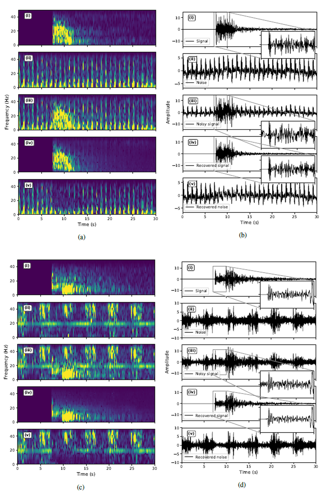
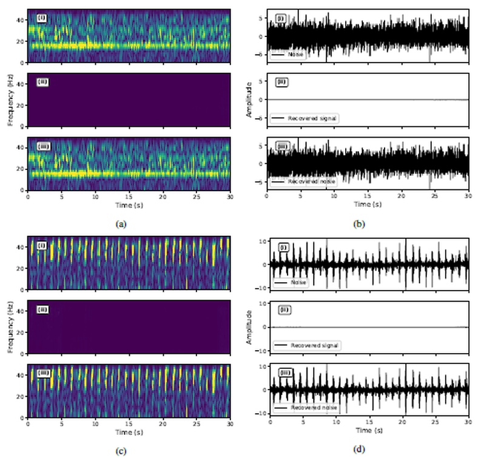
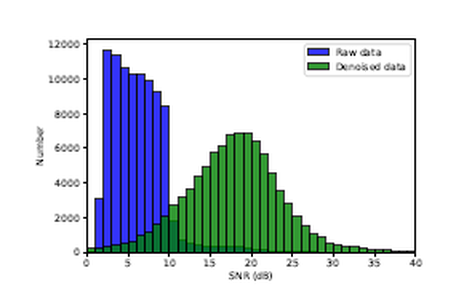
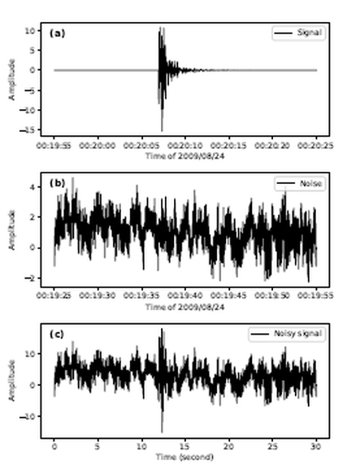
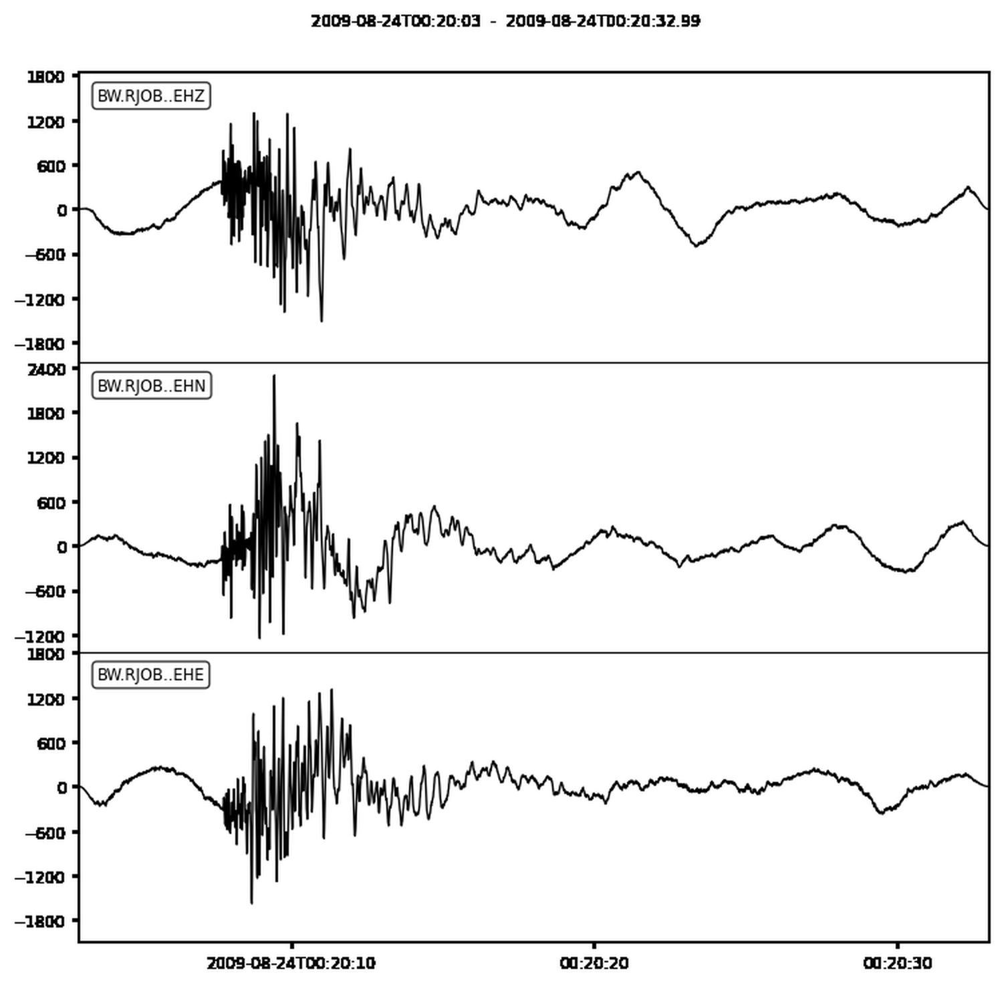
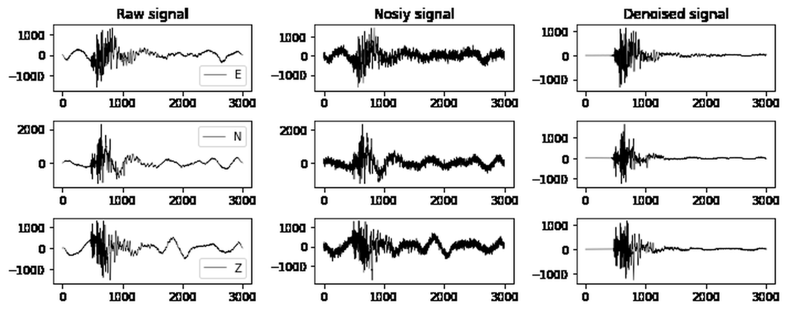
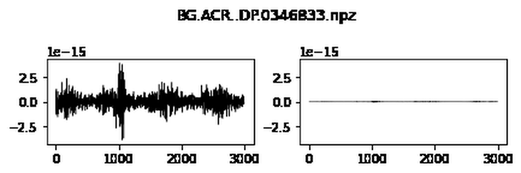
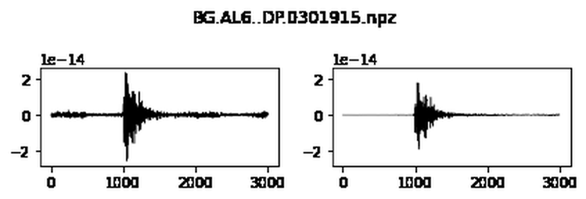
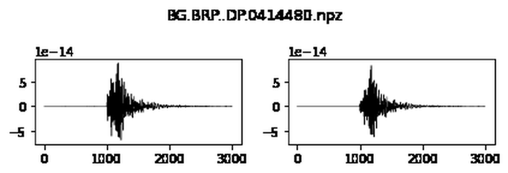

# Technical Report: Seismic Signal Denoising and Decomposition Using Deep Neural Networks

**English-language technical adaptation of the supplied Persian report**  
**Repository documentation prepared by Erfan Yavari**  
**Method under discussion:** DeepDenoiser, originally introduced by Zhu, Mousavi, and Beroza (2019).

> This document converts the central technical discussion, mathematical method, figures, and reported outcomes of the supplied 24-page Persian-language report into an English narrative. It is an **adaptation and explanation**, not a verbatim page-for-page translation. Results attributed to the research paper should not be mistaken for evaluations independently run by the two notebooks in this repository. The original Persian report's cover identifies **Rahaleh Mohseni**.

## Abstract

Recorded seismic waveforms contain earthquake signals mixed with instrumental noise, environmental vibrations, and sometimes other non-earthquake events. Such contamination reduces signal-to-noise ratio (SNR) and can degrade event detection, amplitude estimation, and downstream interpretation. Conventional frequency filtering is often inadequate where desired seismic content and unwanted components overlap in the frequency domain. This report reviews DeepDenoiser, a deep-learning approach that operates on short-time Fourier transform (STFT) representations and predicts masks for seismic signal and noise. The associated demonstrations inspect existing model outputs rather than training a new network. We describe the signal model, convolutional encoder-decoder architecture, training approach reported in the literature, reported tests, and use in earthquake detection, before documenting the accompanying Python/ObsPy notebooks.

## 1. Motivation and problem formulation

Seismic stations measure ground motion rather than earthquake motion alone. Typical contamination sources include ocean-generated microseisms, traffic, wind, instrument self-noise, electrical interference, and overlapping non-earthquake signals. Band-pass filtering is useful when contaminating and seismic frequency bands are separate. It is less effective when the two components share frequencies or have time-varying spectral structure.

In the short-time Fourier domain, the measured recording is written as

$$Y(t,f)=S(t,f)+N(t,f),$$

where $Y$ is the complex STFT of the recorded waveform, $S$ the seismic contribution, and $N$ the residual/noise contribution. The task is to estimate $S$ (and preferably $N$) from $Y$, preserving arrival times, frequency structure, and amplitude where possible.

A general masking approach defines

$$\widehat{S}(t,f)=M_S(t,f)\,Y(t,f),$$

$$\widehat{N}(t,f)=M_N(t,f)\,Y(t,f).$$

The reconstructed time-domain waveforms are then

$$\widehat{s}(t)=\operatorname{iSTFT}(\widehat{S}(t,f)), \qquad \widehat{n}(t)=\operatorname{iSTFT}(\widehat{N}(t,f)).$$

The method uses masks estimated by a trained neural network instead of choosing fixed passbands manually. Both real and imaginary components of $Y$ are passed to the network as input channels, allowing the prediction to use information associated with amplitude and phase.

## 2. Neural network architecture

**Figure 1.** Network architecture presented in the supplied report and original literature.

The described system has a fully convolutional encoder-decoder layout. Convolutional layers with ReLU activations extract progressively more compact representations, with downsampling in the encoder. The decoder upsamples the latent representation to recover maps matching the original time–frequency resolution. Skip connections transmit higher-resolution information between corresponding parts of the architecture. Batch normalization is used during training. The report describes 3 × 3 convolutional filters, decreasing and increasing spatial dimensions, and a softmax output mechanism to produce the component masks.

A key conceptual distinction is that the system predicts **masks** over the observed STFT; it does not directly generate an unconstrained clean waveform from nothing. Because the masks discussed in the report operate between 0 and 1, reconstruction is not equivalent to an arbitrary amplification of masked coefficients. This also creates a limitation when the desired clean complex coefficient magnitude exceeds that in the contaminated observation.

**Figure 2.** Conceptual inference pipeline. Input waveform -> STFT -> neural network signal/noise masks -> masked STFTs -> inverse STFT -> recovered waveforms.

## 3. Training formulation described in the source study

The supplied report summarizes the published training procedure, which combined cleaner seismic examples with non-earthquake/noise segments. It describes **56,345** high-SNR earthquake examples and **179,233** noise examples, with data separated into training, validation, and test subsets. No such dataset or split manifest is provided in this repository, so these figures are **literature-reported dataset sizes** rather than a dataset processed by these notebooks.

During training, a seismic waveform is mixed with noise at varying amplitudes to generate a wide range of apparent noise conditions. The mixed recordings are transformed with STFT, producing the network inputs. The predicted outputs are signal/noise masks, and the described architecture optimizes a supervised loss based on ground-truth target masks. Validation data is used for tuning and overfitting checks, and held-out data for final evaluation.

A complete independent reproduction of this section would require the original data selections, preprocessing and target-mask generation, model code, weights, optimizer settings, and evaluation splits. They are **not included** in the two supplied notebooks.

## 4. Results described in the source report

### 4.1 Basic signal/noise separation

**Figure 3.** Examples combining time–frequency views with time-domain waveforms. The published illustrations show noisy input, target/clean signal, estimated seismic signal, and estimated noise.

The reported outcome is that the mask-based approach can suppress undesired components while maintaining recognisable earthquake arrivals in the waveform. The images are examples from the literature-based report; they should not be interpreted as quantitatively verified outputs of the supplied notebook pair.

### 4.2 Structured and time-varying noise

**Figure 4.** Denoising with strong colored noise.

**Figure 5.** Non-earthquake signals whose frequency structure changes with time.

The report distinguishes narrowband interference, low-frequency background noise, and more challenging time-varying cyclic interference. A fixed passband can be relatively effective when unwanted frequencies are stable and distinct. Learned masks are intended to adapt in time and frequency, including situations in which unwanted and desired energy overlap.

### 4.3 Inputs containing only noise

**Figure 6.** Noise-only examples. The reported behaviour is that the estimated seismic component is relatively small, while the unwanted component retains the main input activity.

This property matters for continuous seismic monitoring: a useful preprocessing method should avoid creating an apparent earthquake signal when there is no earthquake in the input. Assessment must nevertheless be made against labeled noise-only data and false-positive rates, neither of which was computed in the supplied notebooks.

### 4.4 Application to previously unseen recordings

**Figure 7.** Examples involving field recordings beyond the originally mixed training samples.

**Figure 8.** Distribution of SNR improvement described in the report.

The report summarizes a literature generalization experiment over approximately **91,000** real Northern California earthquake recordings, with improvement reported around **15 dB** in the discussed setting. This figure is not a result reproduced by the notebook pair. It should not be generalized to other instruments, noise settings, or datasets without a matching evaluation protocol.

### 4.5 Comparisons with standard denoising methods

**Figure 9.** Reference waveform, pre-event noise window, and constructed noisy example used in a source-study comparison.

**Figure 10.** Published comparison of conventional filtering, a generalized cross-validation (GCV) denoising approach, and DeepDenoiser.

The report discusses SNR improvement, peak-amplitude deviation, waveform correlation, and selected arrival-time error. The scientific goal is not only larger SNR, but also preservation of the shape and timing of arrivals. In the literature results presented in the report, DeepDenoiser is described as performing favorably under the tested noisy conditions. The supplied notebook examples do not run these baselines and therefore should not be cited as an independent confirmation.

### 4.6 Impact on earthquake detection

**Figure 11.** Illustrative effects of denoising on short-term average / long-term average (STA/LTA) triggering.

A simple event detector monitors the ratio of short-window to longer-window signal statistics. In the source study discussed by the report, the example STA/LTA windows were 0.5 s and 5 s. The report presents cases in which noise obscured arrivals and others in which non-earthquake impulses caused spurious detections. Reducing noise before triggering can make the statistic easier to interpret.

The report lists an evaluation of **10,800** examples in which the reported detection precision changes from **35.14%** on noisy signals to **92.34%** on denoised signals, while recall changes from **17.69%** to **93.76%** under the stated threshold conditions. These are **numbers quoted from the original research discussion**, not measurements obtained from the accompanying notebooks, and should be evaluated within the source study's protocol.

## 5. What the supplied Python notebooks actually execute

### 5.1 `interactive.ipynb`: three-component demonstration

The notebook imports ObsPy, NumPy, Matplotlib, and Requests. It calls `obspy.read()` to load ObsPy's example seismic data; sorts the three traces; converts them to a sample-by-component array; adds Gaussian noise; and posts the noisy waveforms to a `/predict` API endpoint. The response contains the predicted signal trace array under a `vec` key. Finally, the notebook displays raw, noisy, and denoised waveforms for all three components.

**Figure N1.** Saved ObsPy example signal, as shown in the uploaded interactive notebook.

**Figure N2.** Saved 3x3 comparison of original, corrupted, and API-denoised E/N/Z traces.

**Caution:** The notebook output includes HTTP 200 from the prediction call in a previously saved execution. This establishes that the notebook received a response when that output was produced, but does not verify availability of the same remote service now.

### 5.2 `batch_prediction.ipynb`: visualizing existing results

The batch notebook loads matching `.npz` input/result files, takes samples `5000:8000`, selects one stored component using indexing conventions assumed by the original code, and plots each input/output pair on matched y-axis scales. It stops after the first four examples.

**Figures B1–B4.** Existing saved outputs. The underlying `.npz` files have not been supplied, so the notebook cannot reconstruct these exact figures solely from this archive.

## 6. Limitations and possible technical extensions

The literature method uses input-dependent time–frequency masks. Mask-based estimation is potentially limited when a relevant signal coefficient needs to be enhanced beyond the complex amplitude of the observed mixture; direct coefficient prediction is one possible extension. More broadly, expected performance depends on waveform type, training data, instrument sampling, noise processes, and correct preprocessing.

For a reproducible technical portfolio, useful additional steps would be to obtain permission to distribute evaluation data, record environment versions, execute the model from a pinned release or locally available weights, store input/output waveform samples, and calculate SNR gain, correlation, mean-squared error, signal distortion, and event detection outcomes. None of these additional evaluations are claimed to have been performed here.

## 7. References and authorship

1. Zhu, W., Mousavi, S. M., & Beroza, G. C. (2019). Seismic Signal Denoising and Decomposition Using Deep Neural Networks. *IEEE Transactions on Geoscience and Remote Sensing*, 57(11), 9476–9488. https://doi.org/10.1109/TGRS.2019.2926772
2. AI4EPS, original software implementation. https://github.com/AI4EPS/DeepDenoiser
3. AI4EPS, official seismic denoising educational tutorial. https://ai4eps.github.io/homepage/eps207-observational-seismology/lectures/codes/denoising/

**Prepared for this repository by Erfan Yavari:** English technical adaptation, organisation of supplied Python notebooks, code walkthrough, and figure indexing.  
**Original supplied Persian report title-page credit:** Rahaleh Mohseni.  
**Research and published diagrams/results:** Zhu et al. (2019). See [attribution and permissions](attribution_and_reproduction.md).
