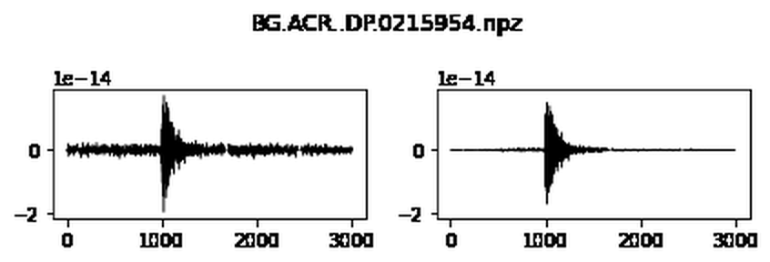
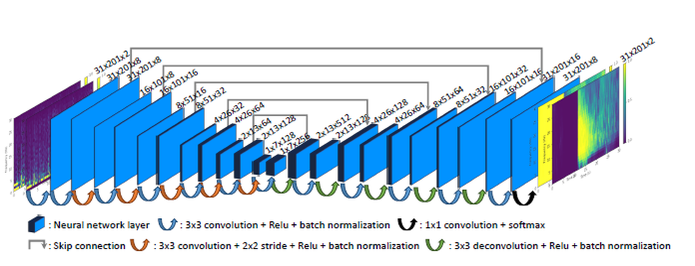
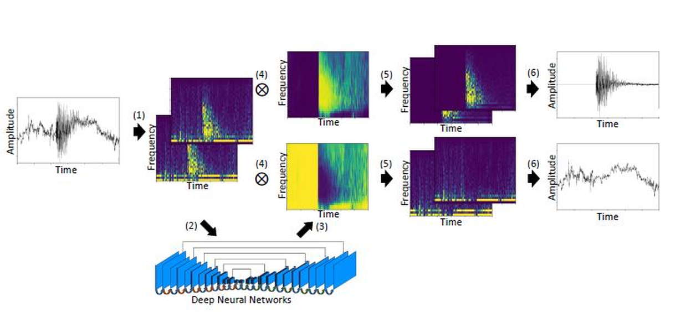
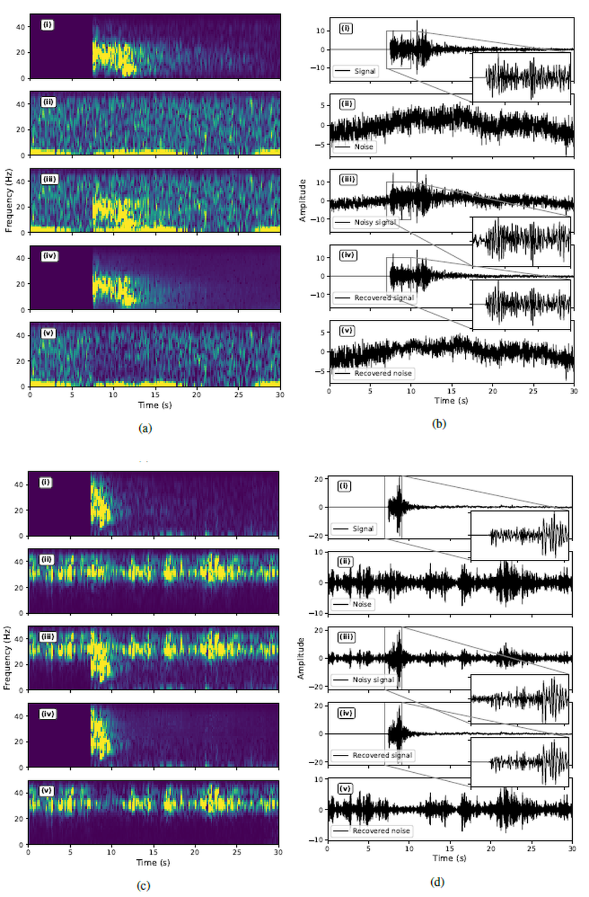
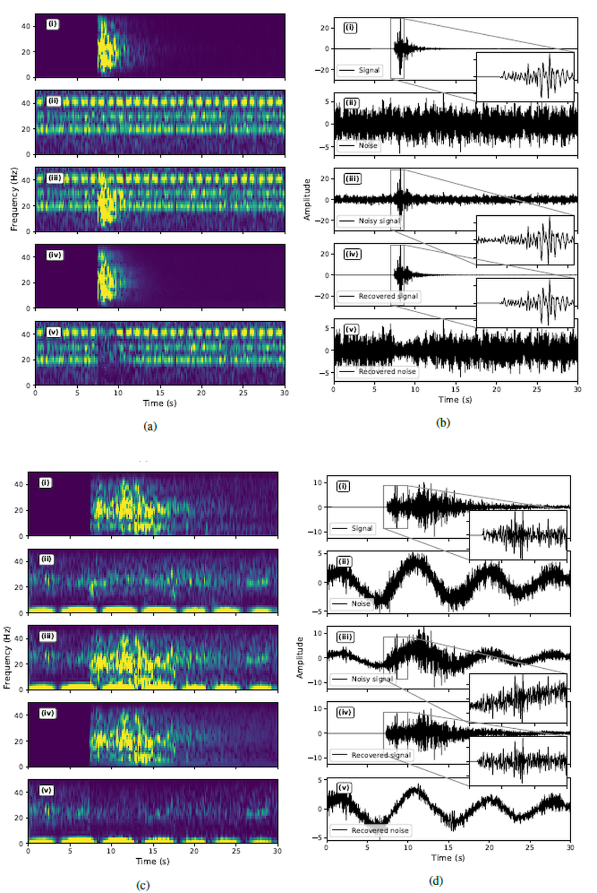
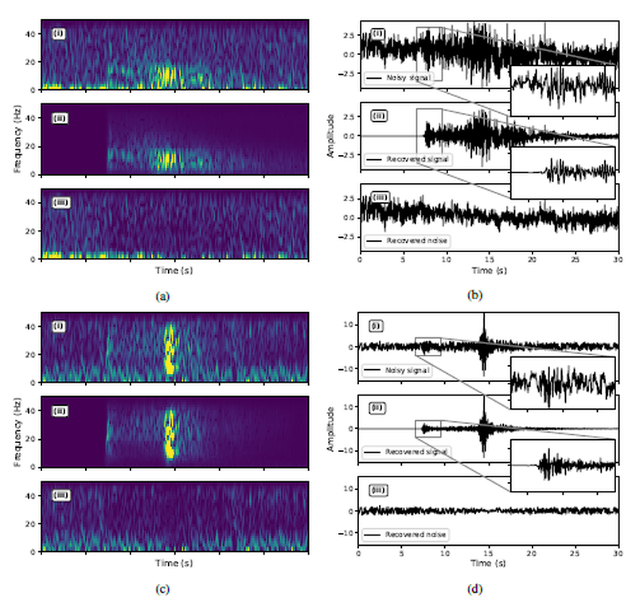
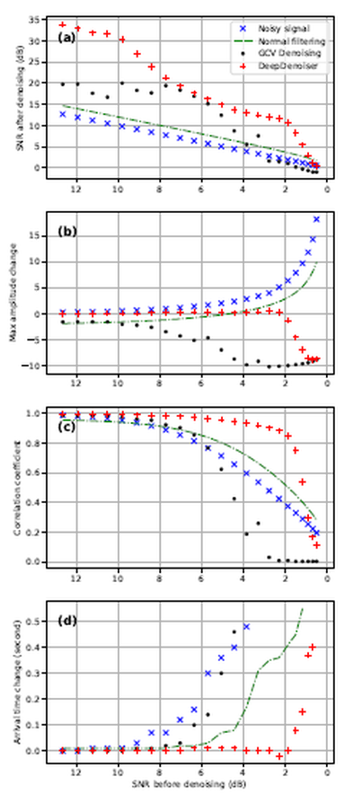
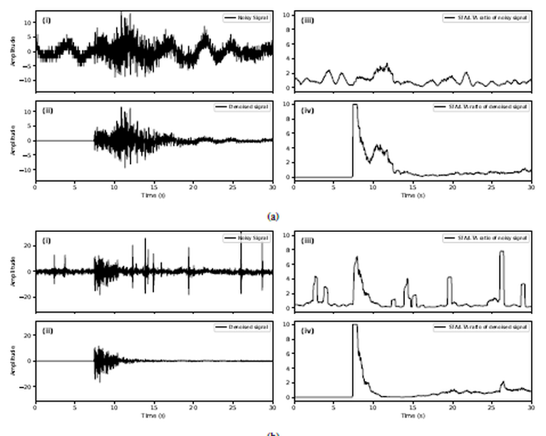

# Seismic Signal Denoising with DeepDenoiser

**Python / ObsPy · Deep learning inference · Three-component seismic waveforms · Signal processing**

**Project documentation and organization:** **Erfan Yavari**  
**Scope:** A documented study of the DeepDenoiser method with two Jupyter notebook demonstrations: interactive denoising via an inference API and visualization of saved batch predictions.

> **Credit and scope:** DeepDenoiser was introduced by **Weiqiang Zhu, S. Mostafa Mousavi, and Gregory C. Beroza** (2019), not developed from scratch in this repository. The supplied Python notebooks follow the project's published examples. This repository explains the workflow, preserves the supplied notebooks and their existing output figures, and summarizes the accompanying Persian-language course report. **Training code, model weights, and complete experimental datasets were not among the supplied files.**

## What this project demonstrates

The objective is to separate earthquake-related seismic motion from added/background noise while retaining meaningful waveform features. Rather than relying solely on a fixed frequency filter, the underlying DeepDenoiser approach predicts time–frequency masks that help estimate both the seismic signal and the noise.

**The attached notebooks specifically demonstrate:**

1. Loading an example three-component seismic waveform using ObsPy.
2. Creating a reproducible-to-describe (but *unseeded*) synthetic noise perturbation.
3. Packaging the noisy waveform into a JSON request for a DeepDenoiser inference service.
4. Visualizing raw, noisy, and denoised **E / N / Z** traces side by side.
5. Plotting previously saved `.npz` batch predictions beside their input traces.

**Notebook result: three-component comparison**


*The figure above was extracted from the saved output of `notebooks/interactive.ipynb`; it is not an independently rerun experiment in this package.*

## Repository layout

```text
.
├── README.md
├── requirements.txt
├── notebooks/
│   ├── interactive.ipynb
│   └── batch_prediction.ipynb
├── assets/
│   ├── notebook_outputs/         # Six figures from saved notebook outputs
│   └── report_figures/           # Eleven numbered figures from the supplied report
├── docs/
│   ├── technical_report_en.md   # English technical adaptation of the Persian report
│   └── attribution_and_reproduction.md
├── test_data/npz/               # Input .npz files must be supplied by the user
└── output/results/              # Batch-prediction .npz files must be supplied
```

## Step-by-step: what the supplied code does

### Step 1 — Import libraries and load a sample waveform

The notebook uses ObsPy to read its packaged demonstration waveform. NumPy prepares numerical arrays; Matplotlib generates plots; Requests communicates with a separate inference API.

```python
import numpy as np
import matplotlib.pyplot as plt
import obspy
import requests

stream = obspy.read()
stream.plot()
```


**Why this matters:** Three-component recordings help represent ground movement along different directions instead of interpreting only one waveform.

### Step 2 — Prepare the E/N/Z input matrix

The notebook sorts the traces and builds an array shaped as **`(number_of_samples, 3)`**. It also extracts a waveform identifier and the recording start time.

```python
stream = stream.sort()
assert len(stream) == 3

data = np.array([trace.data for trace in stream]).T
assert data.shape[-1] == 3

data_id = stream[0].get_id()[:-1]
timestamp = stream[0].stats.starttime.datetime.strftime(
    "%Y-%m-%dT%H:%M:%S.%f"
)[:-3]
```

**Important:** Channel order follows ObsPy's trace sorting; inspect channel names before assuming a particular physical orientation for a different dataset.

### Step 3 — Add synthetic Gaussian noise

The supplied notebook forms a deliberately corrupted signal to test denoising visually:

```python
noisy_data = data + np.random.randn(*data.shape) * np.max(data) / 20
```

This adds an independent random perturbation at each sampled value. The scale is `max(data) / 20` **as written in the original notebook**; it is not a specified target SNR. Because no random seed is set, regenerated noise will differ across runs.

### Step 4 — Request denoising from the API

The notebook constructs a JSON payload with an ID, timestamp, and nested waveform samples and sends it to a `POST /predict` endpoint.

```python
req = {
    "id": [data_id],
    "timestamp": [timestamp],
    "vec": [noisy_data.tolist()],
}

# DEEPDENOISER_API_URL is set in the original notebook.
resp = requests.post(f"{DEEPDENOISER_API_URL}/predict", json=req)
print(resp)

denoised_data = np.array(resp.json()["vec"])
```

The saved notebook output contains **`<Response [200]>`**, showing that the endpoint returned an HTTP 200 response at the time of that notebook execution. **The notebook points to a historic test endpoint** (`http://test.quakeflow.com:8003`); continued accessibility has not been verified. To rerun, configure an active compatible service or use the [upstream project's current instructions](https://github.com/AI4EPS/DeepDenoiser). For production-style requests, add a timeout, check the response status, and validate the returned array shape.

**This notebook calls an existing model service; it does not train DeepDenoiser locally.**

### Step 5 — Compare raw, noisy, and recovered components

The interactive notebook plots a **3 × 3 grid**, with rows corresponding to E, N, and Z and columns to the original signal, synthetic noisy input, and returned denoised output.

```python
# Representative line from the plotted E component:
plt.plot(denoised_data[0, :, 0], "k", linewidth=0.5)
```

The three-component comparison is shown near the top of this README. In the archived output, the predicted traces suppress much of the added noise while retaining a recognizable transient event. This is a qualitative demonstration, **not a measured benchmark**: the notebook does not calculate SNR, MSE, timing error, or aggregate accuracy.

### Step 6 — Visualize saved batch-prediction files

The second notebook searches for existing `.npz` outputs, locates the corresponding original input files, and plots matching time windows for comparison:

```python
import os
import glob
import numpy as np
import matplotlib.pyplot as plt

PROJECT_ROOT = os.path.realpath(os.path.join(os.path.abspath(""), ".."))

for i, fp in enumerate(sorted(glob.glob(
    os.path.join(PROJECT_ROOT, "output/results/*npz")
))):
    signal = np.load(fp)["data"][5000:8000, -1, -1]
    raw_signal = np.load(os.path.join(
        PROJECT_ROOT, "test_data/npz/", os.path.basename(fp)
    ))["data"][5000:8000, -1]

    # The notebook plots the original and recovered windows
    # side by side with a matching y-axis scale.
    if i >= 3:
        break
```

The displayed code uses `os.path.basename(fp)` for portability; the supplied notebook instead uses `fp.split("/")[-1]`. Only the **first four** results are plotted because the loop stops when `i >= 3`.

**Saved output examples:**

| Example 1 | Example 2 |
|:--:|:--:|
|  |  |
| Example 3 | Example 4 |
|  |  |

**Reproduction requirement:** The ZIP does **not** contain the `.npz` input and result files referenced by the notebook. The four plots are exported from notebook outputs that were already present in the files provided for documentation.

## The signal-processing method described in the report

The underlying work models a contaminated time–frequency representation as

$$
Y(t,f) = S(t,f) + N(t,f),
$$

where $S$ denotes earthquake signal and $N$ denotes unwanted noise. A learned mask $M_S(t,f)$ filters the complex-valued short-time Fourier transform (STFT), and inverse STFT reconstructs the signal:

$$
\hat{s}(t) = \operatorname{iSTFT}\big(M_S(t,f)\,Y(t,f)\big).
$$

A separate mask $M_N$ allows corresponding noise reconstruction. The method described in the supplied report uses an encoder-decoder convolutional neural network with skip connections, and masks for the two output components.

**Model architecture (from the supplied literature-based report):**



**Denoising pipeline (literature figure):**



These diagrams describe the **published DeepDenoiser method**, not model layers implemented by the two supplied inference/plotting notebooks. See [the English technical report](docs/technical_report_en.md) for a longer explanation.

## Report figure gallery

The following figures have been extracted from the **supplied Persian-language report**. They summarize experiments discussed in the original DeepDenoiser publication; they are **not new experimental outputs from this repository**.

| Figure | Description | Preview |
|---|---|---|
| 3 | Denoised signal and estimated noise in time–frequency and time domains |  |
| 4 | Examples involving strong colored noise |  |
| 5 | Examples involving non-earthquake cyclic signals |  |
| 6 | Noise-only input and output examples |  |
| 7 | Generalization examples on unseen waveforms |  |
| 8 | Literature SNR-improvement distribution |  |
| 9 | Waveform mixture used for method comparison |  |
| 10 | Literature comparison of filtering, GCV, and DeepDenoiser |  |
| 11 | Literature illustrations of STA/LTA detection after denoising |  |

## Installation and execution notes

```bash
python -m venv .venv
# Linux / macOS:
source .venv/bin/activate
# Windows PowerShell: .venv\Scripts\Activate.ps1

pip install -r requirements.txt
jupyter notebook notebooks/interactive.ipynb
```

For the **interactive demonstration**, verify the configured API endpoint before running the prediction cell. For the **batch visualization**, provide matching `.npz` files in `test_data/npz/` and `output/results/`, then launch Jupyter from the `notebooks/` directory (the notebook derives paths from its current working directory).

**Not supplied:** trained parameters, training scripts, validation/test splits, full waveform datasets, and reproducible benchmark results. Their absence means this repository alone cannot reproduce the original paper's training or reported quantitative experiments.

## Key takeaways

- Real and imaginary STFT channels allow the original DeepDenoiser method to use complex time–frequency information.
- Signal/noise masks are used to separate a wanted seismic waveform from other components.
- The interactive notebook illustrates the end-to-end API inference format on three seismic traces.
- The batch notebook illustrates how to inspect saved prediction files, **not** how to generate those files.
- A research-level assessment would additionally need a defined dataset, reproducible inference endpoint/model, quantitative metrics, and conventional-filter baselines.

## Attribution and references

**Repository compilation and documentation:** Erfan Yavari.  
**Method and figures described in that report:** Zhu, W., Mousavi, S. M., & Beroza, G. C. (2019). *Seismic Signal Denoising and Decomposition Using Deep Neural Networks*. IEEE Transactions on Geoscience and Remote Sensing, 57(11), 9476–9488. **DOI:** https://doi.org/10.1109/TGRS.2019.2926772

- [Original DeepDenoiser implementation (AI4EPS)](https://github.com/AI4EPS/DeepDenoiser)
- [Official AI4EPS tutorial](https://ai4eps.github.io/homepage/eps207-observational-seismology/lectures/codes/denoising/)
- [English technical adaptation of the supplied report](docs/technical_report_en.md)
- [Third-party attribution and reproduction notes](docs/attribution_and_reproduction.md)

> **Figure rights:** The supplied report includes illustrations from a published scientific study. Academic citation does not itself grant redistribution permission. Check the applicable permissions before publishing these figures in a public repository; see the attribution notes for details.
